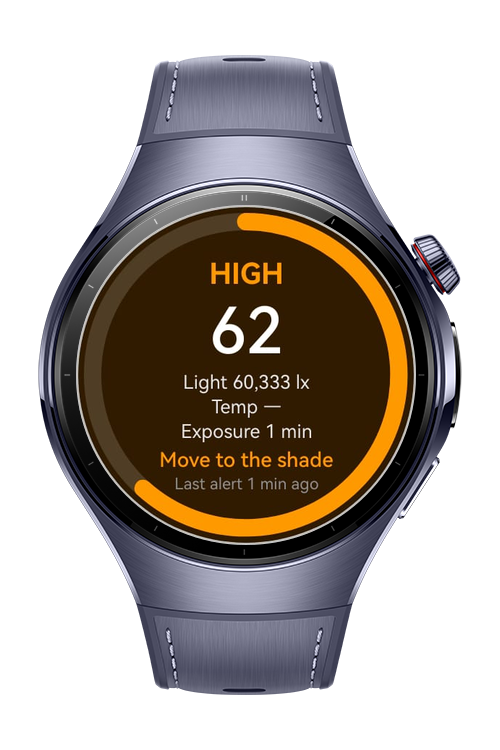
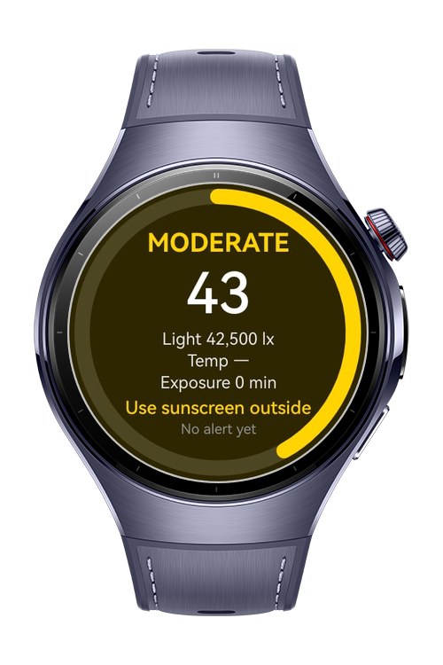

> **Note:** To access all shared projects, get information about environment setup, and view other guides, please visit [Explore-In-HMOS Index](https://github.com/Explore-In-HMOS/hmos-index).

# How to Implement Sun Exposure Risk

This HarmonyOS wearable sample shows how to calculate a sun exposure risk in real time. The app fuses data from the ambient light sensor and the ambient temperature sensor. A tiered risk model changes the data into a score from 0 to 100 and a risk level. The screen shows the level with colors. When the risk is high, the watch vibrates, but not too frequently.

> **NOTE:** The watch does not have a UV sensor. The score is an estimate from light and temperature. Do not use it as a medical or UV index value.

# Preview

<div>
  
  
</div>

# Use Cases

- Fuse ambient light and ambient temperature data with a 5-second moving average
- Calculate a tiered risk level with hysteresis, so that the level does not change too frequently
- Increase the risk when the user stays in strong light for a long time
- Show the risk level with a color-coded ring and smooth color transitions
- Vibrate for high risk with a cooldown for each level
- Continue with one sensor when the other sensor is not available

# Technology

## Stack

- **Languages**: ArkTS, ArkUI
- **Frameworks**: HarmonyOS Stage Model
- **Tools**: DevEco Studio, Hvigor, Hypium
- **Libraries**:
	- `@kit.SensorServiceKit` (`sensor`, `vibrator`)
	- `@kit.ArkUI` (`animateTo`, `Progress`, `Slider`)
	- `@kit.AbilityKit` (`UIAbility`)
	- `@kit.PerformanceAnalysisKit` (`hilog`)
	- `@ohos/hypium` (unit tests)

## Required Permissions

- ohos.permission.VIBRATE

## Sensor Fusion

`SensorFusion` subscribes to `AMBIENT_LIGHT` and `AMBIENT_TEMPERATURE` with a 200 ms interval. The sensor callbacks only add samples to a buffer. One time each second, the page reads the fused values:

- Each value is the average of the last 5 seconds.
- If the newest sample is older than 3 seconds, the value is missing.
- If one value is missing, the model uses only the other value. A banner shows "Partial fusion".
- If both sensors are not available, the app uses simulated data automatically.

The UI updates a maximum of one time each second.

## Risk Model

```
score = (0.7 × light + 0.3 × temperature) × 100 × (1 + exposure gain)
```

| Input | Normalization |
|---|---|
| light | 0 to 100,000 lx changes to 0 to 1 |
| temperature | 15 to 40 °C changes to 0 to 1 |
| exposure gain | +2% for each minute of continuous light at or above 20,000 lx. The maximum is +40%. |

The exposure time resets after 60 seconds below 20,000 lx. A short shadow does not reset it. The score is limited to 100.

| Level | Score | Color | Advice |
|---|---|---|---|
| LOW | less than 25 | Green | No protection needed |
| MODERATE | 25 to 49 | Yellow | Use sunscreen outside |
| HIGH | 50 to 74 | Orange | Move to the shade |
| VERY HIGH | 75 or more | Red | Avoid the sun now |

The level uses a hysteresis of ±3 points. To go up into a level, the score must be at least the bound + 3. To go down out of a level, the score must be less than the bound − 3.

## Haptic Alerts

`HapticThrottler` decides when the watch vibrates:

- Only HIGH and VERY HIGH give an alert.
- HIGH gives a maximum of one alert each 5 minutes.
- VERY HIGH gives a maximum of one alert each 2 minutes.
- When the level goes down and up again, the cooldown continues. It does not start again.
- A change from VERY HIGH down to HIGH does not give an alert during the cooldown.

The app uses the `haptic.effect.hard` preset if `vibrator.isSupportEffectSync` returns true. If not, the app uses a 300 ms vibration.

## Simulated Data

1. Set **Simulated data** to on.
2. Move the **Light (lx)** slider and the **Temperature (°C)** slider.
3. Examine the score, the level, and the color of the ring.

To see all four levels, use these values:

| Level | Light | Temperature |
|---|---|---|
| LOW | 5k | 18 °C |
| MODERATE | 30k | 28 °C |
| HIGH | 60k | 32 °C |
| VERY HIGH | 95k | 38 °C |

> **NOTE:** At 20k lx or more, the exposure gain increases the score each minute. Thus, the level can go up after some minutes with the same slider values. When you change the **Simulated data** switch, the exposure time resets.

## Lifecycle

When the page goes to the background, the app stops the sensors and the timer. The exposure time stops and does not increase in the background.

# Directory Structure

```
entry/
|   src/
|       main/
│   module.json5
│
├───ets
│   ├───common
│   │       Constants.ets
│   │       Logger.ets
│   │
│   ├───entryability
│   │       EntryAbility.ets
│   │
│   ├───model
│   │       ExposureTracker.ets
│   │       HapticThrottler.ets
│   │       RiskLevel.ets
│   │       RiskModel.ets
│   │
│   ├───pages
│   │       Index.ets
│   │
│   └───service
│           Haptics.ets
│           SensorFusion.ets

```

# Constraints and Restrictions

## Supported Device

- Huawei Watch 5
- HarmonyOS smart wearables
- Round-screen wearable layouts are the primary target

## Notes

- Some watches do not give the `AMBIENT_TEMPERATURE` sensor to third-party apps. Then the app uses only the light value.
- The watch body and the wrist can change the temperature value. The temperature is not always the air temperature.

# License

**How to Implement Sun Exposure Risk** is distributed under the terms of the MIT License. See the [LICENSE](LICENSE) for more information.
